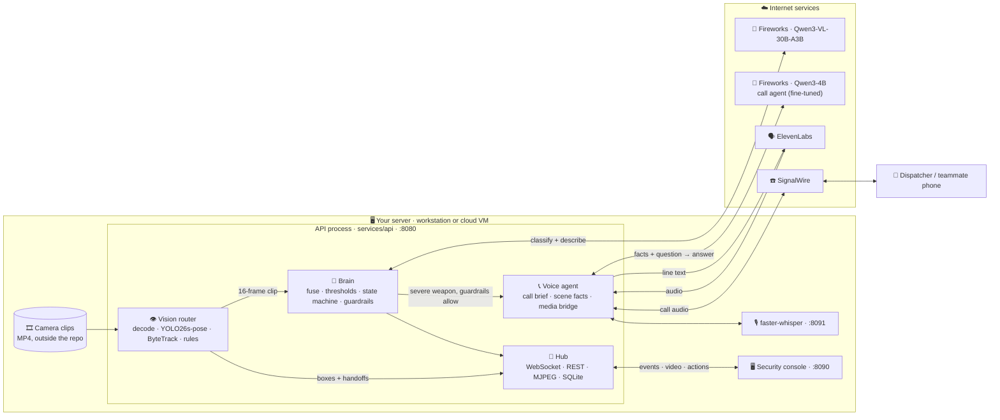

<p align="center">
  <picture>
    <source media="(prefers-color-scheme: dark)" srcset="web/assets/logo-inverse.png">
    
  </picture>
</p>

<h1 align="center">First Witness</h1>

<p align="center">
  <b>The first witness to a campus emergency: it watches every camera, calls for help, and tells the dispatcher only what it can verify.</b>
</p>

<p align="center">
  
  
  <br>
  
  
  
</p>

<p align="center">
  <a href="#-demo">Demo</a> ·
  <a href="#-the-problem">Problem</a> ·
  <a href="#-what-first-witness-does">What it does</a> ·
  <a href="#-the-call-agent">Call agent</a> ·
  <a href="#-privacy">Privacy</a> ·
  <a href="#-a-day-with-first-witness">Story</a> ·
  <a href="#-results">Results</a> ·
  <a href="#-the-team">Team</a> ·
  <a href="#%EF%B8%8F-for-developers">For developers</a>
</p>

---

## 🎬 Demo

> 📺 **Demo video:** coming soon on our Devpost page. <!-- TODO: replace with the Devpost or YouTube link -->

---

## 🤔 The problem

**Cameras record everything. Humans can't watch everything.**

Think about a campus at night. A fight breaks out behind the library. Someone walks into a building with a weapon. A student collapses in an empty stairwell. Almost every one of those moments is on camera. Yet almost every time, **nobody sees it until it's too late**. The footage becomes evidence *after* the fact, not help *during* it.

The problem isn't a lack of cameras. It's a lack of eyes.

<table>
  <tr>
    <td align="center" width="33%"><h2>23,400</h2>on-campus crimes reported at U.S. colleges in 2021</td>
    <td align="center" width="33%"><h2>2.1</h2>sworn officers for every 1,000 students</td>
    <td align="center" width="33%"><h2>93%</h2>of public schools already use security cameras</td>
  </tr>
</table>

<sub>Sources: NCES, <i>Criminal Incidents at Postsecondary Institutions</i> (2021) · BJS, <i>Campus Law Enforcement Agencies Serving 4-year Institutions, 2021–22</i> · NCES, <i>School Survey on Crime and Safety, 2021–22</i>.</sub>

A handful of officers can't watch hundreds of screens around the clock. So most cameras are just recording, and nobody is looking.

---

## 💡 What First Witness does

First Witness is like **a security guard who never blinks and can watch every camera at once**.

<!-- TODO: add a how-it-works diagram here. -->

1. **Watch.** Every camera feed, every second.
2. **Detect and track.** YOLO finds every person, ByteTrack keeps an ID on each one, and simple rules flag weapons, falls and running.
3. **Understand.** A vision model (Qwen3-VL) reviews a short clip, names what's happening (weapon, fight, theft, running, medical, or nothing), and describes the people involved.
4. **Check and decide.** Plain-code guardrails decide whether a call is allowed: severity, one call per incident, an hourly cap and a kill switch. The model never decides alone.
5. **Act.** First Witness raises an alert on the security console, **follows the person from camera to camera** on a live campus map, and **phones for help by itself**. On the call, a fine-tuned call agent answers the dispatcher's questions using only verified facts, and gives live updates as they move.

---

## ✨ Key features

| | Feature | What this means for you |
|:---:|---|---|
| 👁️ | **Watches every camera, all the time** | No feed goes unwatched, even at 3 a.m. |
| 🧠 | **Understands what it sees** | It tells a weapon from a fight, a theft, someone running, or a medical emergency, instead of just reacting to movement. |
| 🛡️ | **Never promises help that isn't coming** | It says an officer is on the way only after one has accepted, with their name and ETA, and never claims doors are locked or a warning went out unless it did. |
| 🧭 | **Follows the person across cameras** | When someone moves from the lobby to a hallway, the alert, the map and the call move with them. |
| 📞 | **Calls for help by itself** | It places one call and answers questions like "How many people?", "What weapons?" and "Where are they now?" in a natural voice. |
| ✅ | **Facts, not guesses** | Addresses come from a fixed camera map, never from the AI. Counts and weapons come from what the camera sees at that second. If it doesn't know, it says so. |
| 📢 | **One-click broadcast** | Officers can send a shelter-in-place message to the security team from the console. |
| 🗂️ | **Nothing is lost** | The incident timeline, the full call transcript, and every model's activity and token use are recorded. |
| 🛑 | **Humans stay in control** | One call per incident, an hourly cap, and a kill switch. Officers can confirm or dismiss any incident. |

---

## 📞 The call agent

A small model, **Qwen3-4B-Instruct fine-tuned on Fireworks**, answers the dispatcher. It sees one compact FACTS snapshot (what the cameras show now, the last sighting, the route, officer-accept status and warning status) and the call so far, and answers in one or two spoken sentences. It replaces a keyword router that broke on paraphrases and knew nothing about officers or warnings.

It is trained and graded on five honesty rules:

1. No number, weapon, place, building or name that isn't in the facts.
2. Injuries, identity, intent and sounds: it says it can't verify them.
3. "An officer is coming" **only** after an officer has accepted, with name and ETA. Never "they've arrived".
4. "A warning went out" only if it was sent. Never "the doors are locked".
5. Out of view: it says so and uses the last sighting.

| Piece | Where |
|---|---|
| Model client (timeout, one retry on a cold start, falls back to the rules) | [`services/voice/call_model.py`](./services/voice/call_model.py) |
| Training data, grader and eval | [`finetune/`](./finetune/README.md) |
| Fine-tune and deploy on Fireworks | [`finetune/run_fireworks.sh`](./finetune/run_fireworks.sh) |

The system prompt and message format live in `call_model.py`, and the training data imports them, so the live agent always sends what the model was trained on. If the model is slow or down, the existing keyword rules answer instead.

---

## 🔒 Privacy

**Runs on infrastructure you control; models are served by Fireworks; no face recognition.**

**On the server you run** (a campus workstation or your own cloud VM):
- 📹 Camera video, person detection and tracking
- 🧠 The rules and guardrails that decide whether to call
- 👂 Speech recognition of what the dispatcher says
- 🗂️ The incident history

**What leaves that server, and only when there is an incident:**
- 🖼️ **To Fireworks (Qwen3-VL):** the short clip of flagged frames, resized to 384 px, for classification. Off when `ZRT_BASE_URL` is empty.
- 💬 **To Fireworks (call agent):** the text facts snapshot and the call so far, to answer the dispatcher.
- 🗣️ **To ElevenLabs:** the **text** of each sentence First Witness says on the call. ElevenLabs sends back the spoken audio.
- 📞 **To SignalWire:** the **phone call audio** in both directions, and the text of any SOS broadcast.

**What First Witness never does:** no face recognition, no identity database, no matching against student lists. It only describes what a person looks like, for example "a man in a red polo shirt and jeans".

---

## 📖 A day with First Witness

> *Our demo uses a staged "mock attack" recording played through three synchronized cameras. In live mode, calls go to a verified teammate's phone, **never to 911 or emergency services**. The demo video uses recording mode, described [below](#what-is-live-in-the-demo-and-what-is-pre-computed).*

**02:13:59.** Three cameras show a quiet building. Nothing is happening, and First Witness keeps watching.

**02:14:00.** Armed people walk into the **ground-floor lobby (Camera 1)**. Every person gets a box, and the armed ones turn red. **Weapon, Severe.** A red alert appears on the security console, and the call starts:

> 👮 *"911, what's your emergency?"*
>
> 🤖 *"Hi, this is First Witness at San Jose State. I'm reporting armed people inside MacQuarrie Hall, One Washington Square. I see five handguns and one knife in the ground-floor lobby."*
>
> 👮 *"Okay, how many people do you see?"*
>
> 🤖 *"Give me a moment. Eight people in the ground-floor lobby; five of them armed."*

**02:14:52.** They move into the **east corridor (Camera 2)**. First Witness follows. The map extends the red path, and the **same call** gets an update: *"Update: they have moved from the ground-floor lobby into the east corridor on the ground floor."*

**02:15:47.** They reach the **west corridor near the stairwell (Camera 3)**. Same incident, same call, updated live.

**One detection. One call. Every handoff reported. No human had to notice first.**

```mermaid
sequenceDiagram
    autonumber
    participant Cam as 📹 Camera 1
    participant Eye as 👁️ YOLO + ByteTrack
    participant Brain as 🧠 Qwen3-VL
    participant Rules as 🛡️ Guardrails
    participant Screen as 🖥️ Security console
    participant Voice as 📞 Voice agent
    participant Disp as 👮 Dispatcher

    Cam->>Eye: Live video frames
    Eye->>Eye: Finds people and follows each one
    Eye->>Brain: Something looks wrong: a 16-frame clip
    Brain->>Screen: 🚨 WEAPON, severe, with a description
    Brain->>Rules: Severe weapon incident
    Rules->>Voice: One call per incident, under the cap: place ONE call
    Voice->>Disp: Armed people in the ground-floor lobby
    Disp->>Voice: How many people do you see?
    Voice->>Disp: Eight people; five of them armed
    Cam-->>Eye: Group now on Camera 2
    Eye->>Screen: Map extends the path
    Screen->>Voice: Same call, location updated
    Voice->>Disp: They moved into the east corridor
```

---

## 📊 Results

These are real measurements from the local demo workstation (sample data in [`bench/`](./bench/)).

| What we measured | Result |
|---|---|
| 🎥 Live camera wall with detection boxes | **13–14 frames per second** (up from about 3) |
| 🗣️ ElevenLabs voice: time until the first sound is ready (short line, warm connection) | **157–160 milliseconds** |
| 🧠 Vision model size | **30 billion parameters**, but only about **3 billion** are active at each step. That keeps it fast on one GPU. |
| 🎯 Weapon labels lined up with the demo video | **640 of 649** frames matched |

### Call agent eval (fill in on build day)

Graded by [`finetune/checker.py`](./finetune/checker.py) on held-out phrasings. `test_real` is unseen seconds of the demo clip; `test_synth` is unseen campuses.

| System | Pass, test_real | Pass, test_synth | False promises | Made-up facts | p50 / p95 latency | Cost per 1k answers |
|---|---|---|---|---|---|---|
| Keyword router (before) | 51.1% | n/a | 0.0% | 4.2% | | $0 |
| Qwen3-4B, prompted, no fine-tune | | | | | | |
| **Qwen3-4B fine-tuned** | | | | | | |
| Large model (quality ceiling) | | | | | | |

> **Honest note:** we have not measured detection accuracy yet. The alert thresholds are demo settings, not tuned on labelled data (see [`bench/thresholds.json`](./bench/thresholds.json)).

---

## 👥 The team

**Ayush · Naman · Rahil · Vraj**

---

## 🤖 Use of AI

**Inside the product**, each model has one job. Fast detectors screen every frame, a vision model reasons only about escalated moments, plain-code guardrails decide whether to call, and a small fine-tuned model answers the dispatcher from verified facts. No model decides alone or supplies an address.

**Building it**, we used AI coding and design tools, and we reviewed and tested everything they produced:

- **IBM Bob** (during the original build): shaped the tiered pipeline and the logprob-calibrated confidence.
- **Claude Code, Codex and Cursor:** implementation, debugging and tests, plus the demo video, diagrams and documentation.

---

## 🛠️ For developers

> Everything below is technical. If you're not a developer, you've seen the whole story. Thanks for reading! 👋

**Windows quickstart:** [`docs/WINDOWS_DEMO_SETUP.md`](./docs/WINDOWS_DEMO_SETUP.md)

### Architecture

<!-- TODO: add an architecture diagram here. -->

The camera loop, the brain and the voice bridge all run inside **one API process** (`python -m services.api`). Speech recognition runs as a separate service on the same machine. Fireworks (both models), ElevenLabs and SignalWire are the only internet services.



<details>
<summary><b>How a frame becomes a phone call (the five stages)</b></summary>

1. **Screen.** Every frame on cameras 1–3 goes through YOLO26s-pose. ByteTrack gives each person a stable ID and a direction of travel, and temporal rules (weapon, fall, run, sudden acceleration, long dwell) score what they're doing. Almost everything stops here at near-zero cost.
2. **Escalate.** When the fused score crosses the threshold, the router hands a 16-frame, peak-weighted evidence bundle to the brain.
3. **Judge.** Qwen3-VL (any OpenAI-compatible endpoint: Fireworks or a local runtime) classifies the clip into one of `WEAPON | FIGHT | THEFT | RUN | MEDICAL | BENIGN` using token logprobs (Completion A), and writes a short person description (Completion B).
4. **Decide.** Plain code sets severity (`bench/thresholds.json`: minor ≥ 0.55, severe ≥ 0.80), moves the incident through its states (`NEW → ALERTED → DISPATCH_PENDING → DISPATCHED → TRACKING → RESOLVED`, or `DISMISSED`), and applies guardrails: one dispatch per incident, an hourly cap (`CS_DISPATCH_HOURLY_CAP`, default 6) and a kill switch (`CS_KILL_SWITCH`).
5. **Call.** Only an *allow* places the call. The address and location on the call come from `data/camera_map.json`, never from the model. (An optional watsonx review from the original build, `services/brain/track_ai.py`, still exists but is skipped while `WATSONX_*` is unset, as it is for First Witness.)

</details>

<details>
<summary><b>How the call voice works</b></summary>

- Every line First Witness speaks is a `call.transcript_delta` event. The media bridge sends **only that line's text** to ElevenLabs (`eleven_flash_v2_5`) over one keep-alive HTTPS connection per call (`services/voice/elevenlabs.py`, Python standard library, no SDK).
- ElevenLabs returns `ulaw_8000` audio, SignalWire's phone codec, so chunks go straight onto the call as they arrive.
- If no first chunk arrives within `CS_ELEVENLABS_FIRST_CHUNK_S` (default 1.5 s), or the request fails, that one line is spoken by a **local backup voice** instead.
- The dispatcher's speech is transcribed by faster-whisper on the server. The call agent ([above](#-the-call-agent)) answers from a facts snapshot; if it is unavailable, common questions are answered instantly from `services/voice/scene.py`, which reads the people, weapons and place at the current clip second.

</details>

<details id="what-is-live-in-the-demo-and-what-is-pre-computed">
<summary><b>What is live in the demo, and what is pre-computed</b></summary>

- **Live:** person detection, tracking, camera handoffs, escalation, Qwen incident classification, the dashboard, and (in live mode) the phone call.
- **Pre-computed:** weapon *boxes*. Small handguns in 960×540 footage were not detected reliably live, so `data/feeds/seville_weapon_timeline.json` replays the dataset's hand-drawn weapon boxes by clip time, and the armed person's box turns red.
- **Recording mode:** for the demo video, `CS_CALL_MODE=scripted` plays the on-screen 911 conversation from `services/voice/demo_call.py`. The opening follows a recorded call, First Witness's counts and weapons are read from the scene at that second, and each "they have moved" update lands on the camera handoff. **Recording mode never dials.**
- **Not yet trained:** cross-camera re-identification is a stub (`services/vision/osnet.py`). Handoffs use camera timing and an appearance hash.

</details>

### Tech stack

#### 🎥 Video & vision

| Tech | Version / model | What it does in First Witness |
|---|---|---|
|  | `yolo26s-pose.pt` | Finds every person in each frame and their body pose (17 points per person). |
| ByteTrack | `services/vision/tracker.py` | Stable IDs, direction of travel, and camera-to-camera handoff. |
|  | `ViT-B-16`, `openai` weights | Scores cropped people for unusual activity (VadCLIP-style). |
|  | not pinned | Runs YOLO and CLIP on the GPU (or CPU). |
|   | not pinned | Reads camera video and encodes frames for the live wall. |
|  | `bluenviron/mediamtx:latest` | Optional relay for real RTSP cameras. **Not used in the demo.** |

#### 🧠 Reasoning

| Tech | Version / model | What it does in First Witness |
|---|---|---|
|  | `qwen3-vl-30b-a3b-instruct` on Fireworks (or a local runtime) | Looks at a 16-frame clip, names the incident type by logprobs, and describes the person. |
|  | `qwen3-4b-instruct-2507` + LoRA, on Fireworks | The call agent: answers the dispatcher from verified facts only. |
| Plain Python | — | Fusion, severity thresholds, incident state machine and guardrails. The rules decide, not the model. |

#### 🗣️ Voice & calling

| Tech | Version / model | What it does in First Witness |
|---|---|---|
|  | `eleven_flash_v2_5`, `ulaw_8000` | Speaks each line on the call, streamed straight onto the phone line. |
|  | Compatibility (LaML) API | Places the call, streams call audio both ways, and sends SOS broadcasts. |
|  | `base.en`, int8, CPU | Understands what the dispatcher says, locally. |

#### ⚙️ Backend, web & infrastructure

| Tech | Version | What it does in First Witness |
|---|---|---|
|  | 3.12 | All backend code: a hand-written asyncio HTTP + WebSocket server, no web framework. |
|  | standard library | History of runs, incidents, calls and transcripts. |
|  | no framework, no npm | The whole security console, as plain JavaScript modules with SVG and Canvas. |
|  | static export | The campus map, saved as an image (no map tiles loaded live). |
|   | `docker-compose.yml`, `Makefile` | Packaging and shortcuts. |
| JSON contracts | `contracts/` | Shared, frozen message shapes for incidents, events and the call brief. |

### Services and ports

| Service | What it does | Port / address | Where it runs |
|---|---|---|---|
| **api** | WebSocket hub, REST actions, MJPEG and MP4 streams, SQLite history. Also hosts vision, the brain and the voice bridge. | `8080` | `make api`, or the Docker Compose `api` service |
| **web** | Security console (static files) | `8090` | `python3 -m http.server 8090 --directory web` |
| **ASR** | faster-whisper speech-to-text, `POST /transcribe` | `8091` | `scripts/serve_parakeet.py` (the name is historical) |
| **Fireworks** ☁️ | Qwen3-VL adjudicator and the fine-tuned call agent | `https://api.fireworks.ai/inference` | Cloud. Needs `FIREWORKS_API_KEY`, `ZRT_BASE_URL` and `CS_CALL_MODEL`. |
| **ElevenLabs** ☁️ | Text-to-speech for every call line | `https://api.elevenlabs.io` | Cloud. Needs `CS_TTS_PROVIDER=elevenlabs` and `ELEVENLABS_API_KEY`. |
| **SignalWire** ☁️ | Outbound call, call audio stream, SOS broadcasts | your SignalWire space | Cloud. Calls back to `/signalwire/*` through `CS_PUBLIC_BASE`. |

<details>
<summary><b>API routes</b></summary>

| Route | Purpose |
|---|---|
| `GET /health` | Health check |
| `GET /ws` | WebSocket event stream (`contracts/events.py`) |
| `GET /api/site` | Site and camera map |
| `POST /api/incidents/manual`, `/api/incidents/{id}/dispatch`, `/confirm`, `/dismiss` | Operator actions |
| `POST /api/broadcast` | Security broadcast |
| `GET /voice/status` | Voice readiness (never returns secrets) |
| `POST /signalwire/voice`, `GET /signalwire/media`, `POST /signalwire/sos` | Phone call webhooks and audio stream |
| `GET /mjpeg/{cam}` | Live frames for cameras 1–3 (the exact frames the vision loop saw) |
| `GET /media/{cam}` | Byte-range MP4 for ambient cameras |

</details>

### Folder structure

```text
.
├── contracts/          Shared data shapes: incidents, WebSocket events, call brief (frozen)
├── services/
│   ├── api/            HTTP + WebSocket server, hub, video streams, history DB, vision bridge
│   ├── brain/          Qwen client, fusion, thresholds, state machine, guardrails
│   ├── vision/         Video decode, YOLO26s-pose, ByteTrack, motion rules, CLIP scorer, weapon timeline
│   ├── voice/          SignalWire bridge, media bridge, ElevenLabs client, call agent + model client, scene facts, demo call
│   └── mediamtx/       Optional RTSP relay config (not used in the demo)
├── finetune/           Call-agent training data, grader, eval and Fireworks runbook
├── web/                Security console: plain HTML/CSS/JS, no build step (see web/README.md)
├── data/               Camera map, feed manifests, scene script, weapon timeline
├── scripts/            Timeline builders, speech servers, GPU memory preflight, perf probe, calibration fit
├── bench/              Severity thresholds and the latest performance sample
├── docs/               Setup and stability notes, design docs, README images
├── docker-compose.yml  One machine, one compose file
├── Makefile            Shortcuts: api, check, up, demo
└── .env.example        Settings template. Copy to .env on the machine and never commit it.
```

### Prerequisites

- **Python 3.12** (not 3.13: the voice code uses `audioop`). Docker + Docker Compose only if you use `make up`.
- **For the full live system:** a Linux machine (an NVIDIA GPU keeps the camera wall smooth) and a Fireworks account.
- YOLO and CLIP weights in `services/vision/weights/` (fetched by `services/vision/pull_weights.py`, never committed).
- The demo camera clips, which live **outside the repo** (see below).
- **ElevenLabs and SignalWire are optional and off by default.** Real calls and SMS need `CS_SIGNALWIRE_ENABLED=1`, and only ever go to the one verified number in `SIGNALWIRE_TO_NUMBER`.

### Set up your `.env`

Copy the template and fill it in on the machine. **Never commit `.env`.**

```bash
cp .env.example .env
```

| Setting | What it's for |
|---|---|
| `FIREWORKS_API_KEY` | Bearer key for both models on Fireworks. |
| `CS_CALL_MODEL_URL`, `CS_CALL_MODEL`, `CS_CALL_MODEL_TIMEOUT_S` | The fine-tuned call agent. Empty model means keyword rules only. |
| `ZRT_BASE_URL`, `ZRT_MODEL`, `ZRT_API_KEY_ENV` | The Qwen3-VL adjudicator. Empty URL means forced (offline) classification. |
| `CS_CALL_MODE` | `live` places a real call (to the verified number only). Anything else, including unset, is recording mode: the on-screen call, no dialing. |
| `CS_TTS_PROVIDER`, `ELEVENLABS_API_KEY`, `ELEVENLABS_VOICE_ID` | The call voice. |
| `CS_SIGNALWIRE_ENABLED`, `SIGNALWIRE_*` | Phone calls and SMS. Leave `CS_SIGNALWIRE_ENABLED=0` unless you mean to call. |
| `CS_KILL_SWITCH` | `1` stops every outbound call. |
| `CS_MEDIA_ROOT` | Folder holding the three demo MP4s. |

### Run it

**Three-camera demo.** No GPU and no provider keys are required. Calls and SMS stay off.

```bash
python3 -m services.api --host 127.0.0.1 --port 8080
```

In a second shell:

```bash
python3 -m http.server 8090 --bind 127.0.0.1 --directory web
# open http://127.0.0.1:8090/?ws=ws://127.0.0.1:8080/ws
```

Windows commands are in [`docs/WINDOWS_DEMO_SETUP.md`](./docs/WINDOWS_DEMO_SETUP.md).

**Make targets:**

```bash
make help    # list the targets
make check   # self-checks for brain, api, voice and re-id
make api     # run the API on 127.0.0.1:8080 (no Docker)
make up      # docker compose up --build api
make demo    # prints the steps to start the API and the console
```

<details>
<summary><b>Full live stack on the GPU workstation</b></summary>

Read [`docs/STABILITY.md`](./docs/STABILITY.md) first. Running Qwen and CUDA YOLO together can run the GPU out of memory.

```bash
bash scripts/preflight_gb10.sh   # GPU memory check before starting the big models

# 1. Qwen through the local runtime (keep the GPU fraction at 0.40 so YOLO fits)
zrt serve hf:Qwen/Qwen3-VL-30B-A3B-Instruct-FP8 --force --gpu-memory-fraction 0.40 \
  --extra "--max-model-len=8192"

# 2. API + vision (only after the local runtime is healthy)
set -a; . ./.env; set +a; export PYTHONPATH=.
CS_VISION_SEVILLE=1 CS_VISION_DEVICE=cuda:0 \
  CS_VISION_CONF=0.50 CS_VISION_COOLDOWN_S=600 CS_VISION_MAX_UPSERTS_MIN=1 \
  services/vision/.venv/bin/python -m services.api --host 127.0.0.1 --port 8080

# 3. Console, in another shell
python3 -m http.server 8090 --bind 127.0.0.1 --directory web
# open http://127.0.0.1:8090/?ws=ws://127.0.0.1:8080/ws   (add &nosplash=1 to skip the intro)
```

</details>

### Video feeds and model weights live outside the repo

Video files and model weights are **never committed**. Put the three demo MP4s in a folder next to the repo:

```text
<repo parent>/campus_sentinel_media/feeds/final_demo_3cam_reconstructed/
├── CAM01_lobby_entrance_IN_then_OUT_339s.mp4
├── CAM02_hallway_east_IN_then_OUT_339s.mp4
└── CAM03_hallway_west_IN_then_OUT_339s.mp4
```

- **Override:** `CS_MEDIA_ROOT` points the API at a different folder.
- **In the repo:** the path map ([`data/feeds/seville_option1_3cam_locked.json`](./data/feeds/seville_option1_3cam_locked.json)) and camera IDs and locations ([`data/camera_map.json`](./data/camera_map.json)).
- **Model weights** stay in `services/vision/weights/` (gitignored). Qwen is pulled and cached by the local runtime.

---

## 🤝 Contributing

1. **Read first:** the [For developers](#%EF%B8%8F-for-developers) section and [`docs/STABILITY.md`](./docs/STABILITY.md).
2. **Contracts are shared:** changes to `contracts/` need the whole team's agreement.
3. **Sync:** run `git pull --rebase origin main` before every push.
4. **Never commit** model weights, video clips, API keys, phone numbers or `.env`.

---

## 🙏 Acknowledgments

- **Qwen team**, for Qwen3-VL and Qwen3-4B
- **Fireworks**, for fine-tuning and serving
- **Ultralytics** (YOLO), **ByteTrack**, **OpenCLIP** and **faster-whisper**, the open-source models that power the pipeline
- **ElevenLabs**, for the call voice, and **SignalWire**, for phone calling
- **OpenStreetMap contributors**, for the campus map
- The authors of the **US Mock Attack** CCTV dataset (University of Seville), used for our demo footage <!-- TODO: confirm dataset citation and license -->

<p align="center"><sub>First Witness · an independent student project</sub></p>
